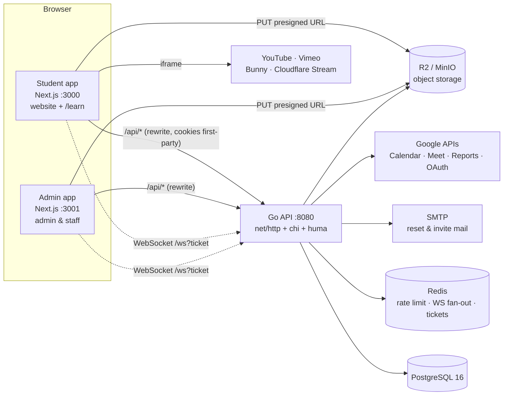
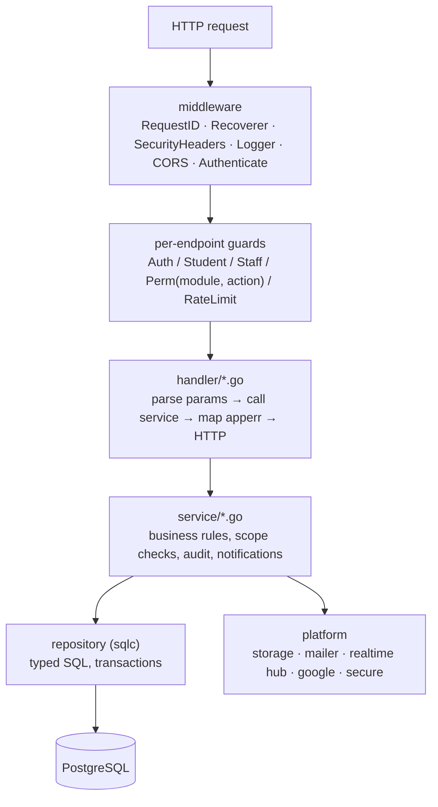
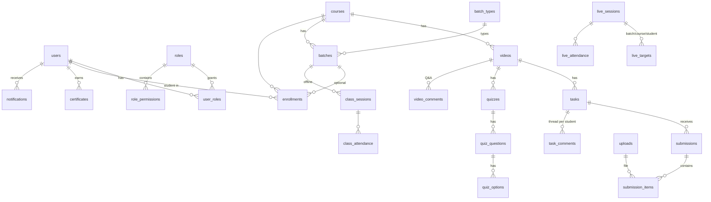
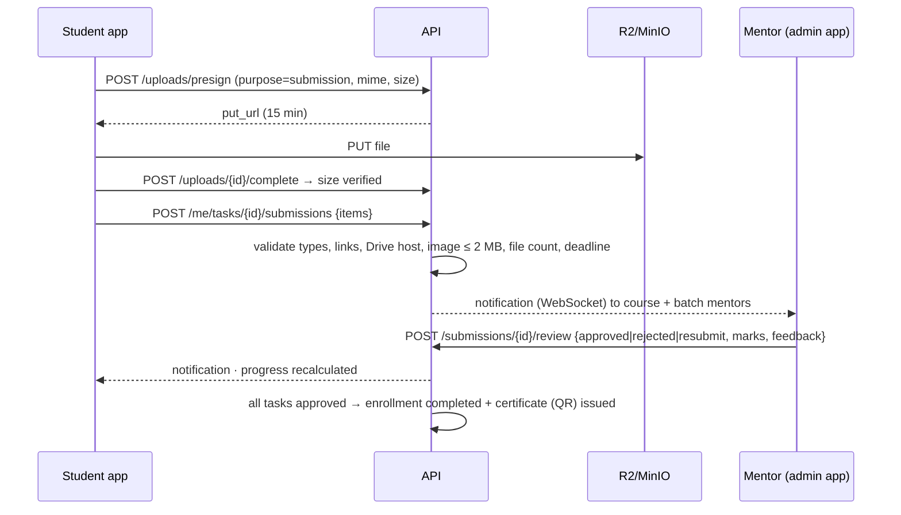

# Architecture

## 1. System overview

* **One API, one database, two frontends.** Both Next.js apps proxy `/api/*` to Go, so auth cookies are first-party for each app.
* **Portal isolation.** Each request carries `X-LMS-App: admin|student`, which picks the cookie pair (`lms_admin_*` / `lms_student_*`). Staff accounts can only sign in to the admin portal and students only to the student portal.
* **Files never pass through Go.** Browsers upload straight to storage with a presigned URL. Downloads go through `/api/v1/files/{id}`, which checks access and redirects to a 10-minute signed link.

## 2. Backend layers (clean architecture)

| Layer | Package | Rule |
|---|---|---|
| Transport | `internal/handler` | Only HTTP concerns: path/query parsing, cookies, status codes. One file per area. |
| Business | `internal/service` | All rules: validation beyond schema, mentor scope, workflow transitions, audit, notifications. **No `net/http` or framework imports**; returns `apperr` errors. |
| Data | `internal/repository` | Generated by sqlc from `db/queries/*.sql`. Compile-time-checked SQL, no ORM. |
| Models | `internal/dto` | Request and response structs with JSON and validation tags (the OpenAPI schema comes from these). |
| Cross-cutting | `internal/middleware`, `internal/auth`, `internal/apperr` | Authentication, guards, typed errors, the permission catalogue. |
| Adapters | `internal/platform/*` | S3 storage, SMTP, WebSocket hub, Google APIs, crypto. Each is replaceable. |
| Wiring | `internal/server` | Builds the router, the services container and the handlers. |

**Services container** (`service.New`): shared helpers (`Access`, `Audit`, `Notify`, `Settings`) are built first and injected into every domain service through an embedded `base`. Reusable pieces such as `curriculum()`, `mentors()`, `history()`, `thread()`, `enrollments()` and `sendInvite()` live on `base`, so admin, portal and public-site services share them.

**Error flow**: services return `apperr.Invalid / NotFound / Forbidden / Conflict / Unauthorized / Unavailable`. `apperr.DB()` maps Postgres errors (unique → 409, FK → 409, check → 422, no rows → 404). `handler.fail()` turns them into RFC 9457 problem JSON. Unknown errors are logged and returned as a generic 500.

## 3. Authentication & sessions

| Item | Implementation |
|---|---|
| Passwords | argon2id (m=19 MiB, t=2, p=1), PHC string, constant-time verify; a dummy verify on unknown emails prevents timing-based user enumeration |
| Access token | HS256 JWT, 15 min, cookie `lms_<app>_at` (httpOnly, SameSite=Lax, Secure in prod) |
| Refresh token | 32 random bytes, SHA-256 hash stored, 7 days, cookie path `/api/v1/auth` only |
| Rotation | Every refresh revokes the old token. **Reusing a revoked token revokes all sessions of that user** (theft detection). |
| CSRF | Cookie-authenticated writes must include `X-LMS-App` (blocked cross-site without CORS approval); SameSite=Lax cookies |
| Google sign-in | OAuth2 with HMAC-signed state (portal + nonce + expiry); links by Google ID, then email; student self-signup if enabled |
| Password reset / invite | One-time hashed tokens (1 h reset, 72 h invite), all sessions revoked after reset |
| Rate limits | Redis fixed window per IP: login 20/min, register 10/h, forgot 5/15 min, leads 10/h, uploads 60/min, check-in 30/min |

## 4. Roles, permissions and mentor scope

* **Catalogue**: 18 modules × 4 actions (`view`, `create`, `edit`, `delete`), defined in `internal/auth/permissions.go`.
* **Roles** hold permission sets; users can have several roles; **super admins** bypass everything.
* **Scoped roles** (e.g. *Mentor*): when all of a user's roles are scoped, `Principal.MentorScope()` returns their id and every list query filters with the SQL helpers `mentor_course_ids()` and `mentor_sees_student()`. A mentor only sees courses they are assigned to (directly or through a batch), those courses' students and submissions, and live sessions they host or that target their groups.
* Permissions are cached per user for 30 s and invalidated on role, user or course-mentor changes.
* The frontend hides menu items and buttons with `useSession().can(module, action)`. The API enforces the same rules on every endpoint, so hiding a button is never the only protection.

## 5. Data model

| Group | Tables |
|---|---|
| Identity | `users` (kind staff/student, `STU1001`-style codes), `refresh_tokens`, `password_resets`, `roles`, `role_permissions`, `user_roles`, `google_tokens` (AES-GCM encrypted) |
| Learning | `courses`, `course_mentors`, `videos` (provider + ref), `tasks` (allowed types, marks, deadline, file limits), `enrollments`, view `enrollment_progress` |
| Work | `uploads`, `submissions` (attempts, status, marks, late flag), `submission_items`, `task_comments` |
| Groups | `batch_types` (admin-defined, online/offline), `batches`, `batch_mentors`, `class_sessions`, `class_attendance` |
| Live | `live_sessions`, `live_targets`, `live_attendance` (join / manual / meet) |
| Assessment | `quizzes`, `quiz_questions`, `quiz_options`, `quiz_attempts` (answers JSONB) |
| Engagement | `certificates`, `video_comments`, `announcements`, `notifications` |
| Website | `cms_blocks` (JSONB), `leads`, `blog_posts`, `settings` |
| Ops | `audit_logs` (actor, action, entity, data JSONB, IP) |

**Progress** = approved tasks ÷ total tasks of the course (the `enrollment_progress` view). When it reaches 100%, the enrollment is marked completed and a certificate is issued automatically.

## 6. Key flows

### Task submission and review

### Live session sync button
| Step | Needs | What happens |
|---|---|---|
| Calendar | Connected Google account (any) + "Calendar sync" on | Creates/updates the event on the institute calendar with every targeted student and mentor as attendees (Google emails the invites) |
| Attendance | Google Workspace admin + "Workspace" on | Reads Admin Reports `call_ended` events for the meeting code and marks matched students present with their minutes |
| Recording | Google Workspace + Meet API | Finds the conference recording and attaches its Drive link; students are notified |
| Always | — | `.ics` download, "Add to Google Calendar" link, Join button (opens 30 min before start, records attendance) |

### Video providers
| Provider | Accepted input | Stored ref | Embed |
|---|---|---|---|
| YouTube | watch / youtu.be / shorts / embed / live / id | `dQw4w9WgXcQ` | youtube-nocookie.com/embed |
| Vimeo | vimeo.com/id[/hash], player.vimeo.com/video/id?h= | `id` or `id:hash` | player.vimeo.com/video |
| Bunny Stream | iframe.mediadelivery.net/embed/lib/guid, `lib/guid` | `lib/guid` | iframe.mediadelivery.net/embed |
| Cloudflare Stream | uid or customer-….cloudflarestream.com link | 32-char uid | iframe.videodelivery.net |

Protection: the iframe is not allowed to go fullscreen. The player's own fullscreen button fullscreens the wrapper, so the **moving watermark (student name + email)** stays visible. Domain-restricted embedding is configured in each provider's dashboard.

### Realtime notifications
`NotificationService.Send` stores rows and publishes to Redis channel `lms:realtime`. Every API instance delivers events to its local WebSocket connections. Browsers connect with a one-time 60-second ticket (`POST /ws/ticket`), reconnect with backoff, and show a toast plus a bell badge.

### Background jobs
`internal/jobs` runs inside the API (disable with `RUN_JOBS=false`). It sends live-class reminders 24 h and 15 min before the start, every minute, and cleans up expired refresh tokens hourly. A Redis `SETNX` lock keeps each job single-instance when several APIs run.

## 7. Frontend architecture

| Package / app | Responsibility |
|---|---|
| `@lms/ui` | Design system: tokens (light/dark, dark default), buttons, inputs, dialogs, tables, tabs, badges, `StatusBadge`, `MultiSelect`, `FileDrop`, `Markdown`, `CodeBlock`, `VideoPlayer` (watermark), `MonthCalendar`, `SubmissionItems`, `ThreadView`, confirm dialog |
| `@lms/api-client` | `createApi()`: openapi-fetch + TanStack Query typed from the OpenAPI spec; single-flight token refresh and retry; `uploadFile()` with progress; `useRealtime()`; `errorMessage()` |
| `@lms/shared` | Components needing both: `NotificationBell`, `ImageUpload` |
| `apps/admin` | `app/(auth)` animated login/reset · `app/(app)` 24 pages behind a permission-aware sidebar · `features/<domain>` forms and dialogs · `lib/session` (`can()`), `lib/feedback` (toast + refetch) |
| `apps/student` | `app/(site)` public pages rendered on the server and cached 60 s (landing, catalog, course, blog, contact, verify, sitemap, robots) · `app/(auth)` · `app/learn` YouTube-style portal (home, courses, watch, tasks, quiz, live, calendar, certificates, attendance, check-in, notifications, profile) |

Data fetching: public pages fetch on the server (`lib/server-api.ts`, cached 60 s, with a fallback if the API is down). Portal pages use typed TanStack Query hooks. After a mutation, `invalidatePaths()` refreshes the affected lists.

## 8. Security checklist

| Area | Measure |
|---|---|
| Injection | sqlc parameterised queries only; no string-built SQL |
| XSS | React escaping; Markdown rendered without raw HTML; links `rel=noopener nofollow`; uploads served from storage domain with `Content-Disposition` |
| Uploads | Mime allow-list per purpose (no SVG/executables), size checked at presign **and** after upload (`StatObject`), random object keys |
| Access | Every endpoint has a guard; services re-check scope and ownership (students only see their enrollments, threads and files) |
| Secrets | Google tokens AES-256-GCM encrypted; refresh/reset tokens stored as SHA-256 hashes; `JWT_SECRET`/`ENCRYPTION_KEY` mandatory in production |
| CSV | Export cells starting with `= + - @` are neutralised (spreadsheet formula injection) |
| Headers | `X-Content-Type-Options`, `X-Frame-Options`, `Referrer-Policy`, COOP; CORS limited to the two app origins |
| Audit | Every create / update / delete / review / export / sync is recorded with actor and IP |

## 9. Performance

* pgx pool (20 connections); indexes on every foreign key plus `(student_id, status)`, `(status, created_at)`, `(starts_at)` and trigram indexes for search.
* List endpoints are paginated, with `count(*) OVER()` totals in the same query; dashboard counts come from single aggregate queries.
* Principal and settings caches (30 s) keep auth checks off the database for most requests.
* gzip for JSON/CSV/ICS; public pages are rendered on the server and cached; files go straight to storage or a CDN (`S3_PUBLIC_URL`).
* The Go binary runs in a ~20 MB distroless image; Next.js runs in standalone output mode.
